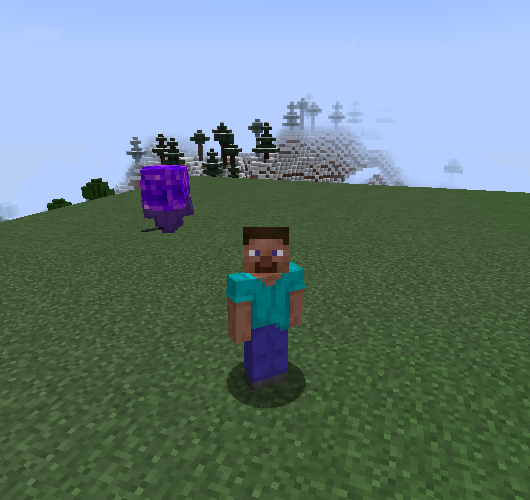
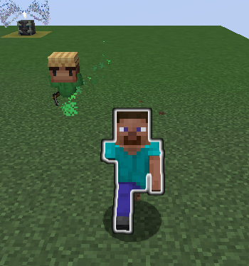
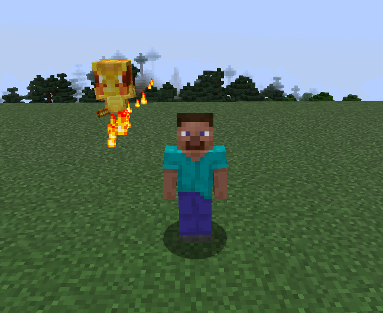

# pnSouls

`pnSouls` — Kotlin-плагин душ-спутников для Paper 1.16.5–1.21.x (Java 17).

Души полностью виртуальны: они не появляются в руках или инвентаре игрока. `/souls` открывает
анимированную коллекцию, где принадлежащую игроку душу можно призвать кликом. Рядом появляется
невидимый ArmorStand, у которого
видны только три настраиваемых элемента: голова, нагрудник и предмет в правой руке. Спутник
следует справа от игрока с интерполяцией, прогнозом скорости, плавным поворотом и анимацией
парения. Между мирами и после больших телепортов позиция безопасно синхронизируется.

## Как выглядят души

<table>
  <tr>
    <td align="center"><br><b>Душа Странника</b></td>
    <td align="center"><br><b>Душа Урожайника</b></td>
    <td align="center"><br><b>Душа Феникса</b></td>
  </tr>
</table>

## Готовые души

- `doubler` — с вероятностью 25% удваивает добычу с моба и даёт вечную сытость;
- `experienced` — утраивает опыт с побеждённых существ;
- `harvester` — ускоряет рост настроенных культур при каждом шаге.

Все параметры, предметы моделей, `custom-model-data`, lore, эффекты и способности находятся в
`souls.yml`. Вероятности роста и математика движения — в `config.yml`.

## Жизненный цикл

- коллекция и активная душа хранятся в PDC игрока;
- при выходе и смерти ArmorStand удаляется, при входе и возрождении создаётся снова;
- состояние переживает перезапуск и аварийное выключение;
- осиротевшие ArmorStand автоматически удаляются при запуске плагина.

## Команды

| Команда | Назначение |
| --- | --- |
| `/souls`, `/pnsouls list` | Открыть анимированную коллекцию душ |
| `/pnsouls give <игрок> <душа>` | Добавить душу в коллекцию (`pnsouls.admin`) |
| `/pnsouls take <игрок> <душа>` | Удалить душу из коллекции (`pnsouls.admin`) |
| `/pnsouls reload` | Перезагрузить настройки (`pnsouls.admin`) |

## Проверка обновлений

Асинхронная проверка GitHub Releases выполняется встроенным модулем pnLibrary для
`Dy6HiLa/pnSouls` каждые шесть часов. Updater не скачивает и не заменяет JAR автоматически.
Новая версия показывается в консоли и игрокам с правом `pnsouls.update`; ссылка на релиз
кликабельна. Параметры updater зафиксированы внутри плагина и не засоряют `config.yml`.

Полный текст первого релиза находится в [`RELEASE-1.0.0.md`](RELEASE-1.0.0.md).

## Сборка

```powershell
./gradlew.bat clean test shadowJar
```

Итоговый JAR создаётся в `build/libs/pnSouls-1.0.0.jar`. Kotlin runtime и pnLibrary встраиваются
в JAR и изолируются relocation, отдельно устанавливать pnLibrary на сервер не нужно.
